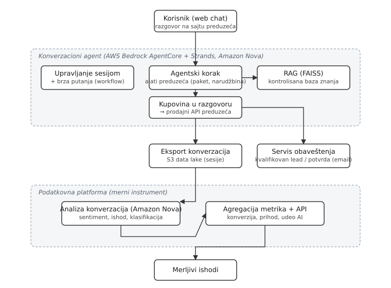

# Uvod

Mala i srednja preduzeća (MSP) sve češće razmatraju konverzacione AI agente kao
način da opsluže rastući obim upita bez proporcionalnog povećanja broja
zaposlenih. Uprkos brzom širenju ovih sistema, dokazi o njihovom poslovnom
efektu i dalje pretežno potiču iz kontrolisanih ili eksperimentalnih uslova
[@luo2019; @schanke2021], dok pregledi literature o adopciji AI u MSP izveštavaju
o fragmentisanim nalazima i pozivaju na više primenjenih, kontekstualnih studija
[@schwaeke2024; @oldemeyer2024]. Posledica je jaz između onoga što je pokazano u
eksperimentu i onoga što se dešava kada takav sistem radi u produkciji jednog
konkretnog preduzeća.

Ovaj rad se bavi jednim uskim, ali praktično važnim pitanjem: može li AI prodajni
chatbot pretvoriti ranije nemonetizovan informativni kanal u merljiv prodajni
kanal, i pod kojim uslovima. Umesto poređenja više raznorodnih slučajeva, biramo
dubinski pristup jednom slučaju sa najčistijom merom ishoda: razgovor vodi ka
potvrđenoj prodaji i prihodu, pri čemu se svaki korak beleži kroz produkcioni
API. Studija se oslanja na iskustvo istog istraživačkog tima sa Fakulteta
tehničkih nauka u Novom Sadu u razvoju višeagentskih AI sistema
[@stojanovic2024telfor].

Doprinos rada je trojak. Prvo, opisujemo AI prodajni chatbot kao inženjerski
artefakt: agentsku arhitekturu, odgovaranje zasnovano na kontrolisanoj bazi
znanja i podatkovnu platformu koja služi kao merni instrument iza poslovnih
brojki. Drugo, definišemo mere (kvalifikovan lead, konverzija, potvrđena
prodaja) i njihov izvor podataka, čime rezultate činimo proverljivim. Treće,
izveštavamo o produkcionim ishodima tokom tri meseca u stvarnom MSP okruženju u
Srbiji i tumačimo ih u odnosu na postojeće nalaze, uz eksplicitno navođenje
ograničenja i konflikta interesa. Rad je uokviren smernicama za studije slučaja
u softverskom inženjerstvu [@runeson2009; @rashid2019].

# Srodni radovi

## AI konverzacioni agenti u prodaji i podršci

Efekti konverzacionih agenata na ponašanje kupaca dokumentovani su u nekoliko
terenskih studija. Luo i saradnici pokazuju da neotkriveni chatbotovi mogu biti
podjednako efikasni kao iskusni ljudski agenti, ali da otkrivanje identiteta
bota pre razgovora značajno smanjuje stopu kupovine [@luo2019]. Schanke i
saradnici ispituju humanizaciju chatbota i nalaze da ona povećava prihvatanje,
ali uz kompromise poput veće osetljivosti na cenu [@schanke2021]. Sistematski
pregled iskustva korisnika sa chatbotovima u podršci mapira dimenzije kvaliteta
i faktore prihvatanja [@nicolescu2022]. Ovi radovi postavljaju fenomen i njegove
dizajn-varijable, ali mere efekte u kontrolisanim uslovima i kratkim vremenskim
okvirima.

## AI adopcija u malim i srednjim preduzećima

Pregledi adopcije AI u MSP izdvajaju barijere poput nedostatka znanja, troškova
i neadekvatne infrastrukture [@oldemeyer2024], a novija sinteza opisuje
literaturu kao fragmentisanu i poziva na više empirijskih, kontekstualnih studija
o tome kako MSP zaista koriste AI [@schwaeke2024]. Kao teorijski okvir za uvođenje
AI u resursno ograničenim MSP u EU predložen je iterativni pristup koji kombinuje
perspektive tehnologije, organizacije i okruženja sa pogledom zasnovanim na
resursima [@zuferi2026toerbv]. Ovaj kontekst je relevantan za naš slučaj:
uvođenje bez novih zaposlenih, uz oslanjanje na postojeće tehničke kapacitete
tima.

## Metodologija studije slučaja

Za opravdanje dizajna i transparentan tretman pretnji validnosti oslanjamo se na
smernice za sprovođenje i izveštavanje studija slučaja u softverskom inženjerstvu
[@runeson2009] i na korak-po-korak vodič za studije slučaja u poslovnim
istraživanjima [@rashid2019]. Te smernice nalažu eksplicitno navođenje pretnji
validnosti, što u našem slučaju uključuje konflikt interesa i izostanak kontrolne
grupe (v. sekciju \ref{sec:metod} i \ref{sec:ogranicenja}).

## Praznina

Postojeća literatura ili meri efekte u kontrolisanim eksperimentalnim uslovima
[@luo2019; @schanke2021], ili u kontekstu MSP poziva na više primenjenih
studija [@schwaeke2024; @oldemeyer2024]. Nedostaje primenjena, produkciona
studija uvođenja AI prodajnog chatbota u stvarnom MSP okruženju sa merljivim
prodajnim ishodima kroz duži period. Ovaj rad popunjava tu prazninu za jedan
slučaj, uz eksplicitno priznanje ograničenja.

# Sistem i arhitektura {#sec:sistem}

Chatbot je implementiran kao višekomponentni sistem na AWS infrastrukturi. Cilj
ovog opisa je da produkcione brojke učini proverljivim kao ishod inženjerskog
artefakta, a ne samo kao poslovnu tvrdnju. Arhitektura se opisuje na nivou
komponenti; interni identifikatori resursa i pristupni podaci nisu navedeni.

Konverzacioni agent radi na upravljanoj agentskoj platformi (AWS Bedrock
AgentCore [@awsbedrock]) uz Strands Agents SDK. Kao osnovni model koristi se
Amazon Nova [@awsnova], koji podržava strukturisani izlaz i pozivanje alata
(function calling). Savremeni jezički modeli ovog tipa počivaju na Transformer
arhitekturi [@vaswani2017attention]. Tok obrade zahteva vodi od korisničkog
razgovora kroz upravljanje sesijom, brzu putanju za strukturisane korake
prodajnog toka i, kada je potrebno, pun agentski korak sa alatima specifičnim za
preduzeće (odabir paketa, kreiranje narudžbine, vođenje workflow-a).

Odgovaranje je zasnovano na pretrazi nad kontrolisanom bazom znanja (RAG)
[@lewis2020rag], gde se relevantni sadržaj pronalazi u vektorskom indeksu
zasnovanom na biblioteci za pretragu sličnosti [@johnson2021faiss]. Baza znanja
se automatski gradi i verzioniše iz sadržaja preduzeća, čime se cene i
informacije drže pod kontrolom i smanjuje rizik od netačnih odgovora. Ovi
arhitektonski izbori (RAG na AWS, izbor izvršnog okruženja) nastavljaju se na
raniju uporednu evaluaciju istog tima [@stojanovic2025aws; @vidakovic2025docker],
te nisu ad hoc odluke.

Kvalifikovani leadovi i potvrde iz razgovora šalju se timu i korisniku
asinhronim servisom za obaveštenja. Zasebna podatkovna platforma automatski
analizira konverzacije (sentiment, teme, kvalitet, ishod) koristeći Amazon Nova
sa strukturisanim izlazom i agregira metrike. Ta platforma je merni instrument
iza brojki u ovom radu: ona definiše šta je jedna konverzacija i klasifikuje
ishode razgovora. Slika \ref{fig:arhitektura} prikazuje tok sistema.

{#fig:arhitektura width=90%}

# Metod {#sec:metod}

Primenjujemo dizajn pojedinačne studije slučaja [@runeson2009; @rashid2019].
Jedinica analize je uvođenje AI prodajnog chatbota u preduzeću Atlas24h (pomoć
na putu), za posmatrani period maj do jul 2026. godine.

## Definicije mera

Da bi rezultati bili proverljivi, mere definišemo eksplicitno:

- **Kvalifikovan lead**: konverzacija u kojoj je korisnik iskazao nameru i
  dostavio podatke potrebne za nastavak prodajnog toka.
- **Konverzija**: udeo kvalifikovanih leadova koji rezultuju potvrđenom
  prodajom, izražen u procentima.
- **Potvrđena prodaja**: transakcija zabeležena kroz produkcioni prodajni API
  preduzeća.

## Izvor podataka

Podaci potiču iz dva izvora u produkciji: prodajnog API-ja preduzeća (potvrđene
prodaje i prihod) i podatkovne platforme opisane u sekciji \ref{sec:sistem}
(klasifikacija ishoda konverzacija i agregacija metrika). Prihod je izražen u
evrima kako je verifikovan u internim izveštajima o slučaju.

## Konflikt interesa {#sec:koi}

Autor je implementator sistema koji se ispituje. Svi podaci su produkcioni podaci
samog preduzeća, bez nezavisne revizije i bez kontrolne grupe. Klasifikacija
ishoda i agregacija metrika izvršeni su instrumentima koje je razvio isti tim.
Ovo predstavlja konflikt interesa i pretnju validnosti koju eksplicitno navodimo;
posledice za tumačenje rezultata razrađene su u sekciji \ref{sec:ogranicenja}.

# Rezultati

Tokom posmatrana tri meseca, prodaja ostvarena kroz AI prodajni chatbot rasla je
i po broju transakcija i po prihodu (Tabela \ref{tbl:rast}). Broj potvrđenih
prodaja porastao je sa 196 u maju na 558 u junu i 1.705 u julu 2026, dok je
verifikovani prihod porastao sa 15.200 na 38.700 i 113.722 evra mesečno.

| Mesec (2026) | Potvrđene prodaje | Prihod (EUR) |
|--------------|-------------------|--------------|
| Maj          | 196               | 15.200       |
| Jun          | 558               | 38.700       |
| Jul          | 1.705             | 113.722      |

: Rast potvrđenih prodaja i prihoda kroz AI prodajni chatbot, maj do jul 2026. {#tbl:rast}

Konverzija u razgovoru porasla je sa 43% na 61% nakon omogućavanja kupovine
unutar samog chata, čime je kanal prešao iz informativne u transakcionu ulogu.
U julu 2026. AI kanal je doprineo sa 1.811 od ukupno 3.905 prodaja, odnosno
46,4% ukupne prodaje. U istom periodu učinak ljudskog call centra ostao je
stabilan (promena od -3,8% na godišnjem nivou), bez povećanja broja zaposlenih.
Ovo ukazuje da je rast AI kanala predstavljao dodatni kapacitet, a ne
preraspodelu postojećeg ljudskog učinka.

# Diskusija

Skok konverzije sa 43% na 61% poklapa se vremenski sa omogućavanjem kupovine u
razgovoru, što sugeriše da je ključni činilac bilo uklanjanje prekida između
namere i transakcije, a ne samo kvalitet konverzacije. Ovaj nalaz je u skladu sa
eksperimentalnim dokazima da konverzacioni agenti mogu ostvariti visoke stope
kupovine [@luo2019] i da dizajn interakcije oblikuje ishode [@schanke2021].
Za razliku od tih studija, naši podaci potiču iz kontinuirane produkcije jednog
preduzeća tokom više meseci, a ne iz kontrolisanog eksperimenta.

Stabilan učinak ljudskog tima uz istovremeni rast AI kanala podupire tezu da
uvođenje ovakvog sistema u MSP može povećati ukupni kapacitet bez novog
zapošljavanja, što je relevantno za barijere adopcije opisane u literaturi
[@oldemeyer2024; @schwaeke2024].

## Ograničenja {#sec:ogranicenja}

Rezultate treba tumačiti uz nekoliko ozbiljnih ograničenja. Prvo, postoji
konflikt interesa: autor je implementator sistema, a svi podaci su produkcioni
podaci preduzeća bez nezavisne verifikacije (sekcija \ref{sec:koi}). Drugo, ne
postoji kontrolna grupa, pa se posmatrani rast ne može pripisati isključivo
chatbotu; sezonski efekti, marketinške aktivnosti i drugi faktori nisu izolovani.
Treće, radi se o jednom slučaju u jednom domenu, što ograničava mogućnost
generalizacije [@runeson2009]. Merni instrument (klasifikacija ishoda) razvio je
isti tim, pa i definicije mera nose rizik pristrasnosti. Ove pretnje validnosti
navodimo eksplicitno, u skladu sa metodološkim smernicama.

# Zaključak

Rad je predstavio produkcionu studiju slučaja uvođenja AI prodajnog chatbota u
malom preduzeću u Srbiji, sa opisom arhitekture kao inženjerskog artefakta,
eksplicitnim definicijama mera i izveštajem o tromesečnim produkcionim ishodima.
Glavni nalaz je da je omogućavanje kupovine u razgovoru pratio rast konverzije
sa 43% na 61% i rast prihoda AI kanala do 113.722 evra mesečno, uz stabilan
ljudski učinak i bez novog zapošljavanja. Doprinos je prvi primenjeni,
produkcioni korak u istraživačkom programu koji je do sada pokrivao arhitekturu i
evaluaciju [@stojanovic2025aws; @vidakovic2025docker], sada usmeren na stvarne
poslovne ishode. Nalaze ograničavaju konflikt interesa, izostanak kontrolne grupe
i oslanjanje na jedan slučaj. Budući rad obuhvata komparativnu analizu četiri
slučaja sa usklađenim metrikama u okviru master rada, čime bi se ublažile pretnje
validnosti vezane za pojedinačni slučaj.

# Reference {-}

::: {#refs}
:::
